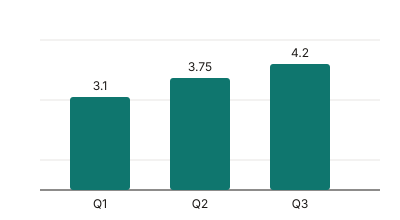

# Q3 Report

"Revenue" -- the number everyone watches -- grew 12% to $4.2M. It's our best quarter since the '90s... or at least since 2019. Dr. Okafor's team shipped 3 x 4 grid layouts and 1920x1080 exports; the median render took 450 ms.

> 'Quality is not an act, it is a habit.' The team took that seriously this quarter.

{width=70%}

## Highlights

1. Shipped the new editor --- three weeks early.
2. Cut p95 latency from 1.2 s to 380 ms.
3. Reduced cloud spend by 1/4 (see p. 3).

| Quarter | Revenue | Growth |
|---------|--------:|-------:|
| Q1      |   $3.1M |    4% |
| Q2      |   $3.75M |  21% |
| Q3      |   $4.2M |   12% |

## Code

Inline `"quotes" -- stay straight` in code.

```js
const label = "don't -- touch... this";
console.log(`${label} 3 x 4`);
```

\pagebreak

## Explicit page break

This section was forced onto its own page with `\pagebreak`. Lorem ipsum dolor sit amet, consectetur adipiscing elit, sed do eiusmod tempor incididunt ut labore et dolore magna aliqua. Ut enim ad minim veniam, quis nostrud exercitation ullamco laboris nisi ut aliquip ex ea commodo consequat.

Duis aute irure dolor in reprehenderit in voluptate velit esse cillum dolore eu fugiat nulla pariatur. Excepteur sint occaecat cupidatat non proident, sunt in culpa qui officia deserunt mollit anim id est laborum.

# Appendix

`breakBeforeH1: true` started this chapter on a new page. The footer counts every page; the header skipped the first.
